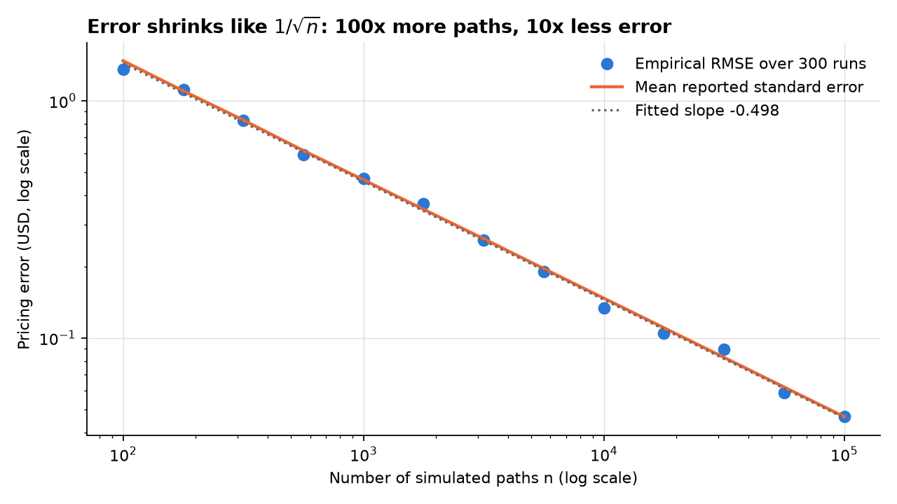
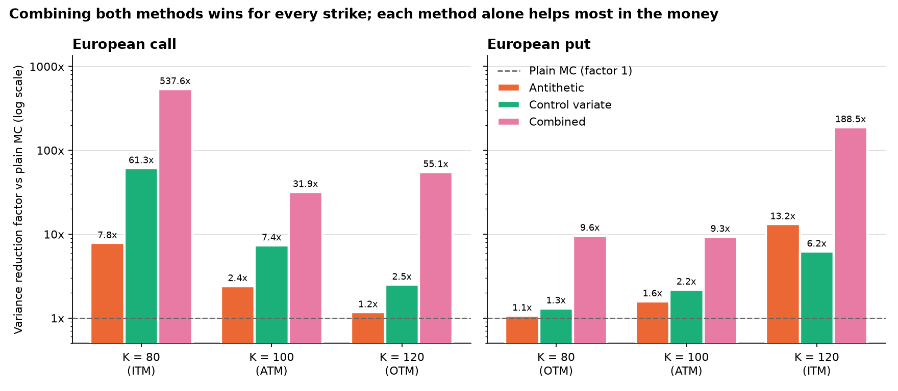
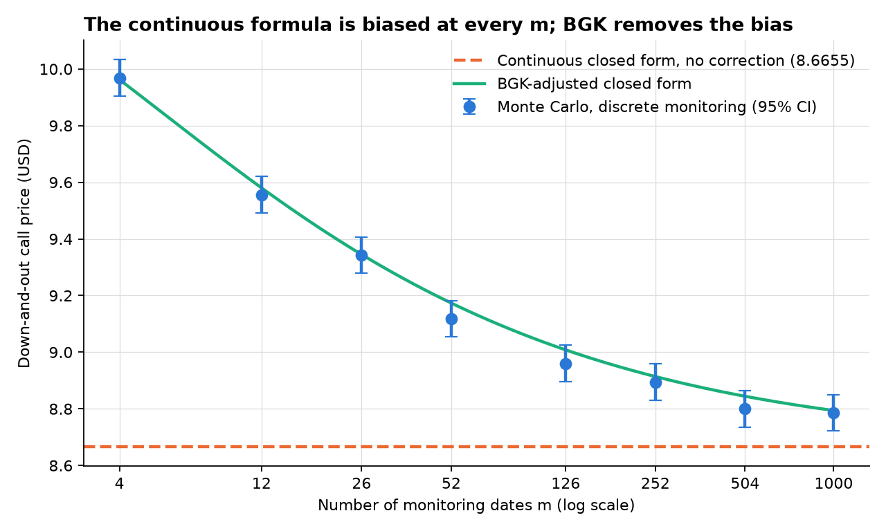
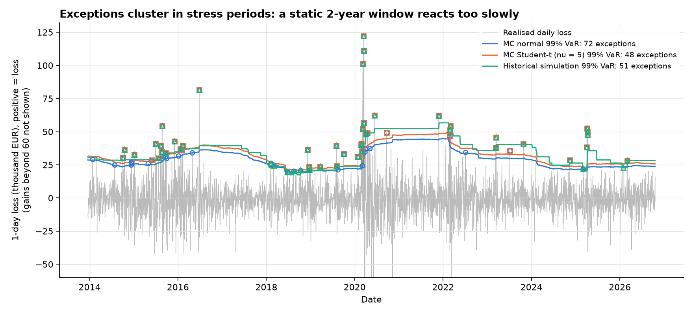

# Monte Carlo Methods in Finance: option pricing and risk measurement

[](https://github.com/finn-mester/monte-carlo-finance/actions/workflows/tests.yml)


A study of Monte Carlo methods for derivatives pricing and market risk, in four notebooks: European options, variance reduction, path-dependent exotics, and VaR and Expected Shortfall on real market data. The guiding principle: **every Monte Carlo result is validated against a closed-form benchmark or a statistical test, and reported with its uncertainty.** A Monte Carlo number without an error bar is not a result.

## About this project

This is a learning project. The code and documentation were written with the help of an AI assistant (Claude, by Anthropic). I directed the work and I am studying the theory behind each part.

## Key results

- **Pricing matches Black-Scholes.** With 1,000,000 paths the call is 10.4578 (standard error 0.0147) against an exact 10.4506. The error decays with slope -0.4983 (theory: -0.5), and 95.10% of 2,000 independent 95% confidence intervals contain the exact price.
- **Variance reduction at equal budget** (at-the-money call, 500 repetitions): the variance falls by 2.41x with antithetic variates, 7.36x with a control variate and 31.92x with both.
- **Arithmetic Asian option** (no closed form): the geometric Asian as a control variate divides the variance by 1,323 at 52 monitoring dates (correlation 0.99962).
- **Discretely monitored barrier option** (weekly, 4,000,000 paths): the continuous formula is off by -0.5064. The Broadie-Glasserman-Kou correction brings the error down to +0.0017.
- **VaR and ES on five CAC 40 stocks** (1 day, 99%, 1,000,000 EUR): VaR 23,717 and ES 27,071 EUR with a normal model, against 26,497 and 34,880 with a Student-t and 28,154 and 43,331 with historical simulation.
- **No model passes the 99% backtest** (3,285 days): 48 to 75 exceptions against 32.9 expected, so the Kupiec test rejects all five, and all fail the independence test because of volatility clustering. At 95%, four of the five pass Kupiec.

<table>
  <tr>
    <td width="50%"><br><sub>The Monte Carlo error decays like 1/√n and matches the reported standard error.</sub></td>
    <td width="50%"><br><sub>Variance reduction by strike: combining both methods wins everywhere.</sub></td>
  </tr>
  <tr>
    <td width="50%"><br><sub>Discrete-monitoring bias of a barrier option and the BGK correction.</sub></td>
    <td width="50%"><br><sub>99% VaR backtest: exceptions cluster in stress periods.</sub></td>
  </tr>
</table>

## Notebooks

Each notebook reads top to bottom like a short report, with its outputs saved.

| Notebook | Question |
|---|---|
| [01_european_options](01_european_options.ipynb) | Can a simulation recover the Black-Scholes price, and how far can we trust it? |
| [02_variance_reduction](02_variance_reduction.ipynb) | How much more precise can the price become at the same budget? |
| [03_exotic_options](03_exotic_options.ipynb) | What do we do when the formula is missing (Asian) or wrong (barrier)? |
| [04_var_es](04_var_es.ipynb) | How much can a portfolio lose in a day, and do the models survive a backtest? |

## How to run

```bash
pip install -r requirements.txt
jupyter notebook    # open a notebook and run it top to bottom
pytest              # 30 tests, offline, synthetic data only
```

Notebook 4 downloads the prices from Yahoo Finance into `data/` the first time it runs. The data is not redistributed. The results above use the download of 2026-10-22 (2012-01-02 to 2026-10-20); a later download will extend the period and slightly change the Part 4 numbers.

## Project structure

```
.
├── mc_utils.py                  all shared functions, grouped in commented sections
├── 01_european_options.ipynb
├── 02_variance_reduction.ipynb
├── 03_exotic_options.ipynb
├── 04_var_es.ipynb
├── figures/                     figures saved by the notebooks
├── tests/test_mc_utils.py       essential checks
├── requirements.txt
└── .github/workflows/tests.yml  runs the tests on Python 3.10 to 3.12
```

## Limitations

- All pricing assumes Black-Scholes dynamics: constant volatility and rates, no jumps, no smile.
- Barrier options: down barriers on calls only. The Monte Carlo prices the discretely monitored contract, with no Brownian-bridge correction.
- The VaR models assume i.i.d. returns and use square-root-of-time scaling for 10 days, which the backtest itself contradicts.
- The risk portfolio is five linear equity positions with no options, and covariance estimation error is ignored. The parametric VaR linearises the P&L, so it differs from the exact Monte Carlo by about 1.8%.
- The backtest reuses the same random draws every day, which correlates the Monte Carlo errors of consecutive days. There is no formal ES backtest.
- This is a learning project, not a validated or regulatory model.

## License

MIT, see [LICENSE](LICENSE).
