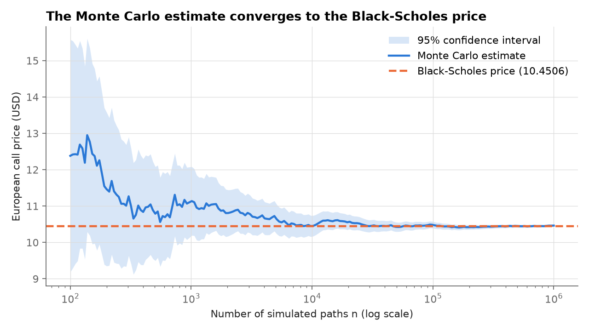
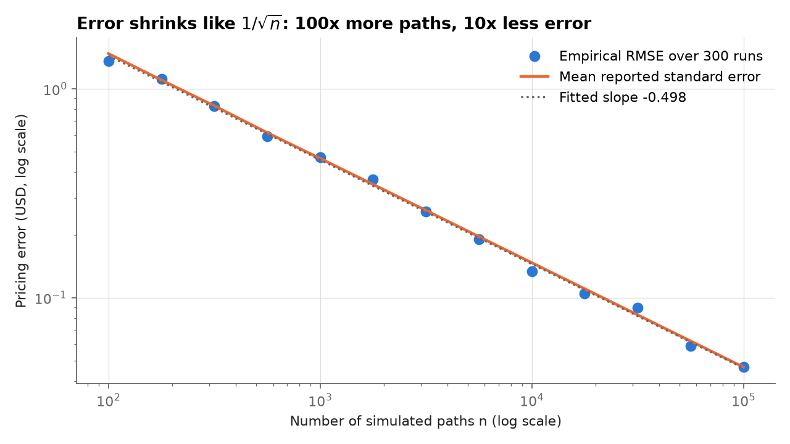
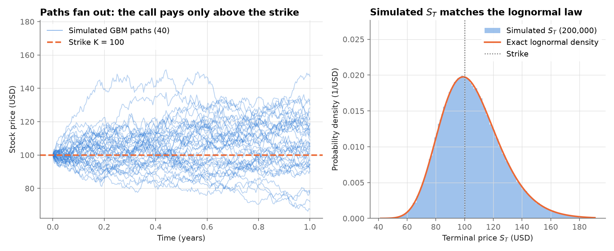
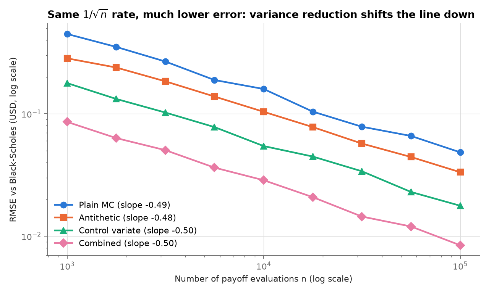
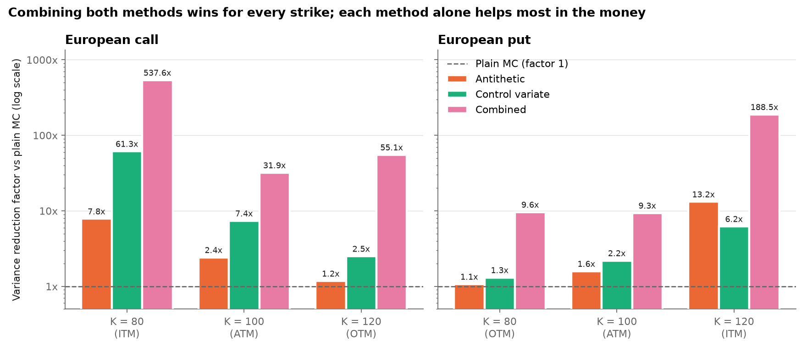

# Monte Carlo Methods in Finance: option pricing and risk measurement

A from-scratch Python implementation of Monte Carlo methods for derivatives pricing and risk management. The guiding principle: **every Monte Carlo result is validated against a closed-form benchmark, reported with a confidence interval, and covered by automated tests.** A Monte Carlo number without an error bar is not a result. This project shows how big the error bar is, checks that it shrinks at the rate theory predicts, and checks that the 95% interval contains the true value about 95% of the time.

## Roadmap

| Part | Topic | Status |
|---|---|---|
| 1 | European option pricing by Monte Carlo, validated against Black-Scholes | Done |
| 2 | Variance reduction (antithetic variates, control variate), compared at equal budget | Done |
| 3 | Exotic option pricing (path-dependent payoff) | Planned |
| 4 | Value at Risk and Expected Shortfall | Planned |

## Quick start

```bash
python -m venv .venv
source .venv/bin/activate          # Windows: .venv\Scripts\activate
pip install -r requirements.txt

pytest                             # run the test suite
python scripts/run_part1.py        # reproduce the Part 1 table and figures
python scripts/run_part2.py        # reproduce the Part 2 tables and figures
```

```python
from mcfinance import bs_price, price_european

res = price_european(S0=100, K=100, r=0.05, sigma=0.2, T=1.0, n=1_000_000, rng=42)
print(res)                          # price +/- standard error, 95% CI, n
print(bs_price(100, 100, 0.05, 0.2, 1.0))
```

## Part 1: European option pricing

### Method

**Model.** Under the risk-neutral measure $\mathbb{Q}$ the stock follows a geometric Brownian motion with risk-free rate $r$, dividend yield $q$ and volatility $\sigma$:

$$dS_t = (r - q)\,S_t\,dt + \sigma\,S_t\,dW_t .$$

This SDE has an exact solution, so $S_T$ can be sampled directly with no time-discretisation error:

$$S_T = S_0 \exp\!\Big(\big(r - q - \tfrac{1}{2}\sigma^2\big)T + \sigma\sqrt{T}\,Z\Big), \qquad Z \sim \mathcal{N}(0,1).$$

**Estimator.** The option price is the discounted expected payoff, $V_0 = e^{-rT}\,\mathbb{E}_{\mathbb{Q}}[h(S_T)]$ with $h(S) = (S-K)^+$ for a call and $(K-S)^+$ for a put. With $n$ independent draws $S_T^{(i)}$ and $Y_i = e^{-rT}h(S_T^{(i)})$:

$$\hat V_n = \frac{1}{n}\sum_{i=1}^{n} Y_i .$$

**Standard error and confidence interval.** By the central limit theorem $\hat V_n$ is approximately normal with standard error

$$\mathrm{SE} = \frac{s_n}{\sqrt{n}}, \qquad s_n^2 = \frac{1}{n-1}\sum_{i=1}^{n}\big(Y_i - \hat V_n\big)^2,$$

and the 95% confidence interval is $\hat V_n \pm 1.96\,\mathrm{SE}$. The error therefore decreases like $1/\sqrt{n}$: 100 times more paths give 10 times less error.

**Benchmark.** Each estimate is compared with the Black-Scholes closed form, $C = S_0 e^{-qT}N(d_1) - K e^{-rT}N(d_2)$, $P = K e^{-rT}N(-d_2) - S_0 e^{-qT}N(-d_1)$.

### Results

Contract: $S_0 = 100$, $K = 100$, $r = 5\%$, $\sigma = 20\%$, $T = 1$ year, no dividends, seed 42. Black-Scholes prices: call **10.4506**, put **5.5735**. Full table in [`results/part1_pricing_table.csv`](results/part1_pricing_table.csv).

| Option | n | MC price | Std. error | 95% CI | Black-Scholes | Abs. error | CI contains BS |
|---:|---:|---:|---:|---:|---:|---:|---:|
| Call | 1,000 | 9.9120 | 0.4483 | [9.0332, 10.7907] | 10.4506 | 0.5386 | yes |
| Call | 10,000 | 10.3887 | 0.1481 | [10.0983, 10.6790] | 10.4506 | 0.0619 | yes |
| Call | 100,000 | 10.4260 | 0.0468 | [10.3342, 10.5178] | 10.4506 | 0.0246 | yes |
| Call | 1,000,000 | 10.4578 | 0.0147 | [10.4289, 10.4866] | 10.4506 | 0.0072 | yes |
| Put | 1,000 | 5.3208 | 0.2668 | [4.7978, 5.8438] | 5.5735 | 0.2527 | yes |
| Put | 10,000 | 5.5536 | 0.0866 | [5.3839, 5.7232] | 5.5735 | 0.0200 | yes |
| Put | 100,000 | 5.5543 | 0.0273 | [5.5008, 5.6078] | 5.5735 | 0.0192 | yes |
| Put | 1,000,000 | 5.5687 | 0.0087 | [5.5517, 5.5856] | 5.5735 | 0.0049 | yes |

Additional checks produced by the same script:

- **Convergence rate.** Over 300 independent runs per sample size ($n$ from $10^2$ to $10^5$), the fitted log-log slope of the RMSE against $n$ is **-0.4983** (theory: -0.5).
- **Interval calibration.** Over 2,000 independent runs with $n = 10{,}000$, **95.10%** of the 95% confidence intervals contain the Black-Scholes price.

**Convergence of the running estimate** (single sample of 1,000,000 paths):



**Error scaling**: empirical RMSE against Black-Scholes and the mean standard error reported by the estimator:



**Simulated paths and terminal distribution**: the histogram of $S_T$ matches the exact lognormal density:



## Part 2: Variance reduction

Plain Monte Carlo error falls like $\sigma_X/\sqrt{n}$. Halving it costs four times as many paths. Variance reduction lowers $\sigma_X$ instead. All methods below are compared at the **same budget**: $n$ is always the total number of payoff evaluations.

### Method

**Antithetic variates.** Draw $n/2$ normals $Z_i$ and use each one twice, as $Z_i$ and $-Z_i$. With $X(Z) = e^{-rT}h\big(S_T(Z)\big)$:

$$\hat V^{\text{AV}} = \frac{1}{n/2}\sum_{i=1}^{n/2} \frac{X(Z_i) + X(-Z_i)}{2}.$$

The $n/2$ pair averages are i.i.d., but the two members of a pair are negatively correlated. The standard error must therefore be computed from the pair averages, with $n/2$ observations, and not from the $n$ individual payoffs. The method helps when the payoff is close to monotone in $Z$: writing $X = X_{\text{even}} + X_{\text{odd}}$, the pair average removes the odd part $X_{\text{odd}}$ exactly.

**Control variate.** Use $Y = e^{-rT}S_T$, whose expectation is known exactly because the discounted asset is a martingale under $\mathbb{Q}$: $\mathbb{E}[Y] = S_0e^{-qT}$. The adjusted estimator

$$\hat V^{\text{CV}} = \frac{1}{n}\sum_{i=1}^{n}\Big(X_i - \beta\,\big(Y_i - \mathbb{E}[Y]\big)\Big)$$

is unbiased for any fixed $\beta$. Its variance is minimised by

$$\beta^* = \frac{\operatorname{Cov}(X,Y)}{\operatorname{Var}(Y)}, \qquad \operatorname{Var}\big(X - \beta^*(Y - \mathbb{E}[Y])\big) = (1-\rho^2)\operatorname{Var}(X),$$

so the variance reduction factor is $1/(1-\rho^2)$, where $\rho = \operatorname{Corr}(X, Y)$. $\beta^*$ is estimated from the same sample, which introduces a bias of order $1/n$, negligible next to the $1/\sqrt{n}$ statistical error at these sample sizes.

**Combined.** The control variate is applied to the antithetic pair averages $\big(\tfrac{X(Z)+X(-Z)}{2}, \tfrac{Y(Z)+Y(-Z)}{2}\big)$. The averaged control still has expectation $S_0e^{-qT}$.

### Results

**At-the-money call** ($K = 100$, same contract and seed as Part 1). Full table in [`results/part2_pricing_table.csv`](results/part2_pricing_table.csv).

| Method | n | MC price | Std. error | 95% CI | Black-Scholes | CI contains BS |
|---:|---:|---:|---:|---:|---:|---:|
| Plain MC | 10,000 | 10.3452 | 0.1477 | [10.0558, 10.6346] | 10.4506 | yes |
| Antithetic | 10,000 | 10.4289 | 0.1042 | [10.2246, 10.6333] | 10.4506 | yes |
| Control variate | 10,000 | 10.4111 | 0.0557 | [10.3019, 10.5203] | 10.4506 | yes |
| Combined | 10,000 | 10.4539 | 0.0276 | [10.3999, 10.5079] | 10.4506 | yes |
| Plain MC | 100,000 | 10.3799 | 0.0468 | [10.2883, 10.4716] | 10.4506 | yes |
| Antithetic | 100,000 | 10.4738 | 0.0329 | [10.4092, 10.5384] | 10.4506 | yes |
| Control variate | 100,000 | 10.4352 | 0.0177 | [10.4004, 10.4699] | 10.4506 | yes |
| Combined | 100,000 | 10.4606 | 0.0086 | [10.4438, 10.4775] | 10.4506 | yes |

The combined estimator with 10,000 paths (standard error 0.0276) is more precise than plain Monte Carlo with 100,000 paths (0.0468).

**Variance reduction by strike.** Each method was run 500 times with $n = 10{,}000$. The VR factor is $\operatorname{Var}(\text{plain price}) / \operatorname{Var}(\text{method price})$, measured from the spread of the 500 prices, not from the reported standard errors. The efficiency gain is $\text{VR factor} / (t_{\text{method}} / t_{\text{plain}})$, i.e. the variance reduction per unit of CPU time. Full data in [`results/part2_variance_reduction.csv`](results/part2_variance_reduction.csv).

| Option | K | Moneyness | Antithetic VR | Control variate VR | Combined VR | Antithetic eff. | Control variate eff. | Combined eff. |
|---:|---:|---:|---:|---:|---:|---:|---:|---:|
| Call | 80 | ITM | 7.84 | 61.34 | 537.63 | 9.41 | 40.31 | 436.27 |
| Call | 100 | ATM | 2.41 | 7.36 | 31.92 | 2.89 | 4.83 | 25.90 |
| Call | 120 | OTM | 1.18 | 2.50 | 55.10 | 1.41 | 1.64 | 44.71 |
| Put | 80 | OTM | 1.07 | 1.31 | 9.61 | 1.28 | 0.86 | 7.80 |
| Put | 100 | ATM | 1.58 | 2.19 | 9.34 | 1.90 | 1.44 | 7.58 |
| Put | 120 | ITM | 13.17 | 6.21 | 188.54 | 15.81 | 4.08 | 152.99 |

**Cost per estimator call** at $n = 10{,}000$ (best of 5 repeats of 200 calls; the cost does not depend on the strike):

| Method | Time per call (ms) | Time ratio vs plain |
|---:|---:|---:|
| Plain MC | 0.240 | 1.00 |
| Antithetic | 0.200 | 0.83 |
| Control variate | 0.366 | 1.52 |
| Combined | 0.296 | 1.23 |

**Control variate: theory vs measurement.** The predicted factor $1/(1-\rho^2)$, with $\rho$ estimated from one run of 1,000,000 paths, matches the measured factor:

| Option | K | Moneyness | rho | Predicted 1/(1-rho^2) | Measured factor |
|---:|---:|---:|---:|---:|---:|
| Call | 80 | ITM | 0.9922 | 63.97 | 61.34 |
| Call | 100 | ATM | 0.9242 | 6.86 | 7.36 |
| Call | 120 | OTM | 0.7517 | 2.30 | 2.50 |
| Put | 80 | OTM | -0.4448 | 1.25 | 1.31 |
| Put | 100 | ATM | -0.7613 | 2.38 | 2.19 |
| Put | 120 | ITM | -0.9228 | 6.74 | 6.21 |

**Error vs sample size** (at-the-money call, 300 runs per $n$). All four methods converge at the same $1/\sqrt{n}$ rate. The fitted slopes are -0.4916 (plain), -0.4788 (antithetic), -0.4993 (control variate) and -0.5017 (combined). Variance reduction lowers the constant, not the rate:





### Discussion

- **Where the control variate helps most: in-the-money calls.** A deep in-the-money call behaves almost like the stock itself, so its payoff is almost perfectly correlated with $S_T$ ($\rho = 0.9922$ at $K = 80$) and the variance falls by a factor of 61.
- **Where it helps little: out-of-the-money options.** For the $K = 120$ call, most payoffs are zero whatever the exact value of $S_T$, so the payoff is only partly linear in $S_T$ ($\rho = 0.7517$, factor 2.50). For the $K = 80$ put, the payoff is non-zero only in the lower tail and $\rho = -0.4448$. The factor is then 1.31, and after the extra cost of estimating $\beta$ the efficiency gain is **0.86, below 1**: on this contract the control variate alone is slightly worse than plain Monte Carlo per unit of CPU time.
- **Antithetic variates** follow the same pattern. They remove the part of the payoff that is odd in $Z$, so they help most when the payoff is close to linear in $Z$ (deep in the money: 7.84 for the $K = 80$ call, 13.17 for the $K = 120$ put). For out-of-the-money options the payoff is mostly convex and one-sided, so the factor is close to 1 (1.18 and 1.07). Because antithetics need only $n/2$ normal draws, they are also slightly cheaper than plain MC (time ratio 0.83), so their efficiency gain is above 1 in every case measured.
- **Why combining works much better than either method alone.** On the out-of-the-money call, the two methods alone give 1.18 and 2.50 but together give 55.10. This is not a coincidence. The antithetic pair average removes the odd part of the payoff and leaves its even, convex part. The averaged control $\tfrac{1}{2}\big(Y(Z)+Y(-Z)\big)$ is proportional to $\cosh(\sigma\sqrt{T}Z)$, which is also even and convex. It is therefore strongly correlated with what remains of the payoff. The two methods attack different components of the variance, so their effects compound.
- **Runtime trade-off.** At $n = 10{,}000$ the control variate costs 1.52 times plain MC per call, because of the extra arrays and the covariance estimate. Combined costs 1.23 times. These overheads are small next to the variance reductions, except for the out-of-the-money put case above. Timings depend on the machine; the ratios are the meaningful part.

## Project structure

```
.
├── src/mcfinance/
│   ├── gbm.py              # exact GBM simulation (terminal values and full paths)
│   ├── black_scholes.py    # closed-form benchmark
│   ├── pricing.py          # MC estimator, MCResult with CI, convergence curve
│   └── variance_reduction.py  # antithetic, control variate, combined, VR measurement
├── tests/                  # pytest suite
├── scripts/
│   ├── run_part1.py        # reproduces the Part 1 table and figures
│   └── run_part2.py        # reproduces the Part 2 tables and figures
├── results/                # generated table and figures
├── pyproject.toml
└── requirements.txt
```

## Testing

```bash
pytest
```

The suite (57 tests) checks:

- Black-Scholes against textbook values (call 10.4506, put 5.5735), put-call parity across strikes and dividend yields, monotonicity in volatility, and input validation.
- Monte Carlo call and put prices within 4 standard errors of Black-Scholes ($n = 400{,}000$).
- Reproducibility with a fixed seed.
- Standard error halves when the sample size is multiplied by 4.
- 95% CI coverage between 92% and 98% over 500 repetitions.
- $\mathbb{E}[S_T] = S_0 e^{(r-q)T}$ (martingale property of the discounted price).
- Path shapes, consistency between `convergence_curve` and `price_european`, and invalid inputs.
- Variance reduction: each estimator (antithetic, control variate, combined) within 4 standard errors of Black-Scholes for calls and puts, with and without dividends; a smaller standard error than plain MC at the same $n$; reproducibility; odd $n$ rejected for antithetic sampling.
- 95% CI coverage between 92% and 98% for each variance reduction method. This checks that their standard errors are computed correctly, in particular that antithetic pairs are not treated as independent.
- The measured control-variate factor matches $1/(1-
ho^2)$ within 15%; a payoff identical to the control gives zero variance; the estimated $eta$ equals the regression slope.

## Assumptions and limitations

- Black-Scholes world: constant volatility and interest rate, continuous dividend yield, lognormal prices, no transaction costs. Real markets show volatility smiles and jumps.
- European exercise only in Part 1. American options need methods such as Longstaff-Schwartz.
- The confidence interval relies on the central limit theorem. It is approximate for small $n$ or for heavy-tailed payoffs.
- Plain Monte Carlo converges slowly ($1/\sqrt{n}$). Part 2 reduces the constant, not the rate. Quasi-Monte Carlo (low-discrepancy sequences) could improve the rate itself and is not covered.
- In Part 2, the control-variate $\beta$ is estimated from the same sample (bias of order $1/n$). Runtime measurements depend on the machine and on NumPy's implementation; only the ratios between methods are meaningful.
- Pseudo-random numbers come from NumPy's PCG64 generator. Results are reproducible for a given seed and NumPy version.
