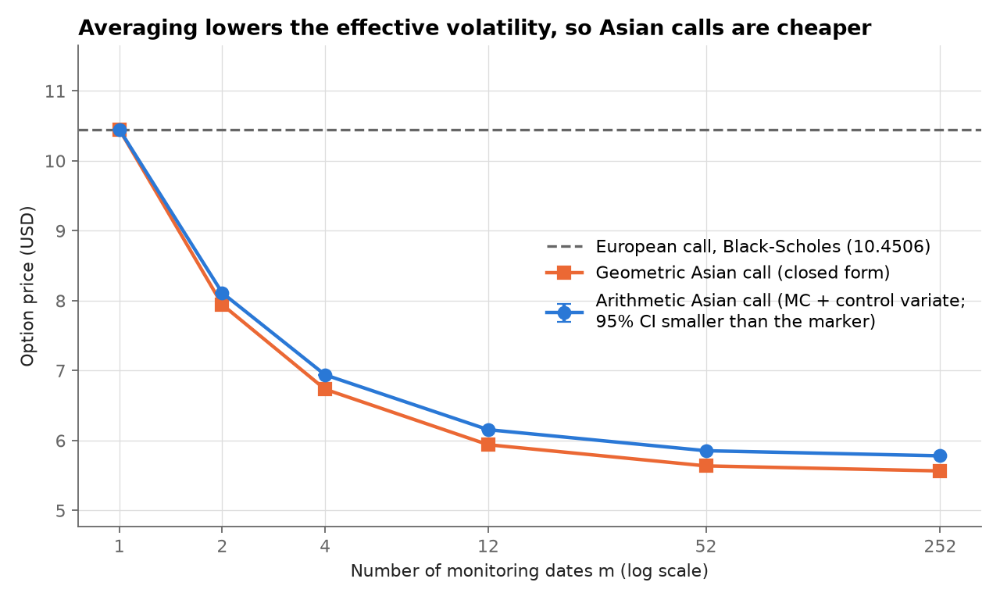
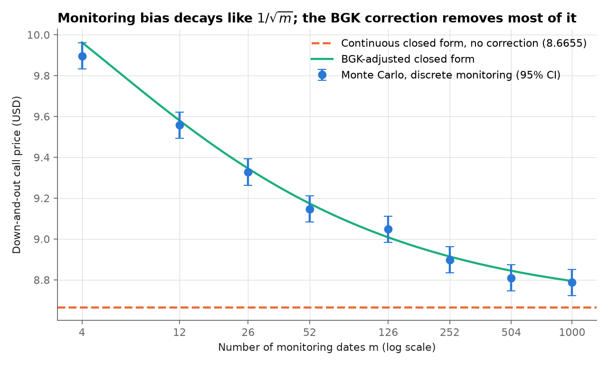
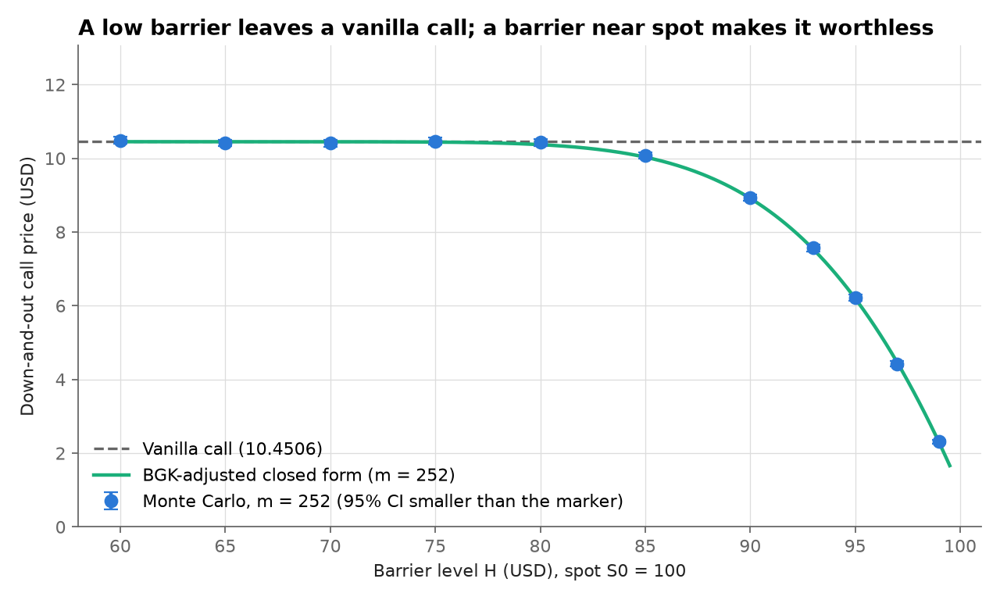

# Part 3: Path-dependent exotic options

[Back to the README](../README.md) · [Part 1](part1_european_options.md) · [Part 2](part2_variance_reduction.md) · [Part 3](part3_exotic_options.md) · [Part 4](part4_var_es.md)

Reproduce with `python scripts/run_part3.py` from the repository root.

Asian and barrier options depend on the whole price path, not only on $S_T$. This is where Monte Carlo becomes genuinely necessary. Monitoring dates are $t_i = iT/m$, $i = 1, \dots, m$; $S_0$ is not a monitoring date. Paths use the exact GBM transition between dates, so the path itself has no discretisation error. Paths are simulated in batches of 20,000 and only per-path payoffs are kept, so memory does not grow with $n \times m$.

## Asian options

**Why Monte Carlo is needed.** The arithmetic Asian call pays $\big(A - K\big)^+$ with $A = \frac{1}{m}\sum_{i=1}^{m} S_{t_i}$. A sum of lognormal variables is not lognormal and has no tractable distribution, so there is no closed-form price.

**Geometric Asian: an exact benchmark.** The geometric average $G = \big(\prod_{i=1}^{m} S_{t_i}\big)^{1/m}$ *is* lognormal, because $\ln G$ is an average of jointly normal variables. Using $\frac{1}{m}\sum_i t_i = T\frac{m+1}{2m}$ and $\frac{1}{m^2}\sum_{i,j}\min(t_i,t_j) = T\frac{(m+1)(2m+1)}{6m^2}$:

$$\ln G \sim \mathcal{N}\big(\mu_G, \sigma_G^2\big), \quad \mu_G = \ln S_0 + \big(r - q - \tfrac{1}{2}\sigma^2\big)T\,\frac{m+1}{2m}, \quad \sigma_G^2 = \sigma^2 T\,\frac{(m+1)(2m+1)}{6m^2},$$

$$C_{\text{geo}} = e^{-rT}\Big(e^{\mu_G + \sigma_G^2/2}\,N(d_1) - K\,N(d_2)\Big), \qquad d_1 = \frac{\mu_G + \sigma_G^2 - \ln K}{\sigma_G}, \quad d_2 = d_1 - \sigma_G .$$

For $m = 1$ this is exactly the Black-Scholes formula, which the tests check. As $m$ grows, $\sigma_G^2$ falls from $\sigma^2T$ towards $\sigma^2T/3$: averaging lowers the effective volatility.

**Geometric Asian: a control variate.** On the same paths, take $X = e^{-rT}(A-K)^+$ and $Y = e^{-rT}(G-K)^+$, with $\mathbb{E}[Y] = C_{\text{geo}}$ known exactly, and use the Part 2 estimator

$$\hat V^{\text{CV}} = \frac{1}{n}\sum_{i=1}^{n}\Big(X_i - \hat\beta\,\big(Y_i - C_{\text{geo}}\big)\Big), \qquad \hat\beta = \frac{\widehat{\operatorname{Cov}}(X,Y)}{\widehat{\operatorname{Var}}(Y)} .$$

On every path the two averages of the same prices are very close ($A \ge G$ by AM-GM, with a small gap), so $\rho = \operatorname{Corr}(X,Y)$ is almost 1 and the variance is divided by $1/(1-\rho^2)$.

**Validation: Monte Carlo geometric Asian call vs closed form** ($K = 100$):

| m | n | MC price | Std. error | 95% CI | Closed form | CI contains exact |
|---:|---:|---:|---:|---:|---:|---:|
| 12 | 200,000 | 5.9542 | 0.0185 | [5.9179, 5.9904] | 5.9402 | yes |
| 52 | 200,000 | 5.6411 | 0.0175 | [5.6068, 5.6753] | 5.6374 | yes |
| 252 | 200,000 | 5.5748 | 0.0173 | [5.5408, 5.6087] | 5.5655 | yes |

**Arithmetic Asian call: plain MC vs geometric control variate.** Prices are at $n = 50{,}000$. The VR factor is measured from 200 independent repetitions at $n = 10{,}000$, and the cost is the best of 3 blocks of 20 calls at $n = 10{,}000$, as in Part 2.

| m | Method | MC price | Std. error | 95% CI | rho | Predicted 1/(1-rho^2) | Measured VR factor | Time ratio | Efficiency gain |
|---:|---:|---:|---:|---:|---:|---:|---:|---:|---:|
| 12 | Plain MC | 6.1906 | 0.0382 | [6.1157, 6.2655] |  |  | 1 | 1.00 | 1 |
| 12 | Control variate | 6.1568 | 0.0011 | [6.1547, 6.1589] | 0.99961 | 1286 | 1152 | 1.06 | 1084 |
| 52 | Plain MC | 5.8768 | 0.0366 | [5.8051, 5.9486] |  |  | 1 | 1.00 | 1 |
| 52 | Control variate | 5.8544 | 0.0010 | [5.8524, 5.8563] | 0.99960 | 1261 | 1010 | 1.02 | 994 |
| 252 | Plain MC | 5.7833 | 0.0358 | [5.7132, 5.8534] |  |  | 1 | 1.00 | 1 |
| 252 | Control variate | 5.7819 | 0.0010 | [5.7800, 5.7838] | 0.99962 | 1304 | 1145 | 1.01 | 1139 |

The control variate divides the variance by about 1,000, or equivalently it gives the precision of roughly 1,000 times as many plain paths. It costs almost nothing, because path simulation dominates the runtime: computing the geometric payoff on paths that already exist costs 1 to 6% extra. All three measured factors are below the predicted $1/(1-\rho^2)$, by 10 to 20%. With 200 repetitions, each variance estimate has a relative uncertainty of about $\sqrt{2/199} \approx 10\%$, so their ratio is uncertain by about 14%. The gaps are therefore consistent with sampling noise, but more repetitions would be needed to rule out a small systematic effect.

**Price vs number of monitoring dates** (arithmetic: MC with control variate, $n = 50{,}000$):

| m | Arithmetic (MC + CV) | Std. error | Geometric (closed form) | European (BS) |
|---:|---:|---:|---:|---:|
| 1 | 10.4506 | 0.0000 | 10.4506 | 10.4506 |
| 2 | 8.1121 | 0.0015 | 7.9434 | 10.4506 |
| 4 | 6.9394 | 0.0012 | 6.7335 | 10.4506 |
| 12 | 6.1552 | 0.0011 | 5.9402 | 10.4506 |
| 52 | 5.8545 | 0.0010 | 5.6374 | 10.4506 |
| 252 | 5.7815 | 0.0010 | 5.5655 | 10.4506 |

With $m = 1$ the arithmetic and geometric averages are both $S_T$, so the control variate is exact (standard error 0). Both Asian prices then coincide with the European price, as they must.

## Barrier options

**Contract.** A down-and-out call pays $(S_T - K)^+\,\mathbf{1}\lbrace S_{t_i} > H \text{ for all } i\rbrace$. The down-and-in call pays when the barrier *is* hit, so on every path knock-in + knock-out = vanilla.

**Continuous closed form** (Reiner-Rubinstein, $H \le K$). With $\lambda = \frac{r - q + \sigma^2/2}{\sigma^2}$ and $y = \frac{\ln\big(H^2/(S_0K)\big)}{\sigma\sqrt{T}} + \lambda\sigma\sqrt{T}$:

$$C_{\text{DI}} = S_0e^{-qT}\Big(\frac{H}{S_0}\Big)^{2\lambda}N(y) - Ke^{-rT}\Big(\frac{H}{S_0}\Big)^{2\lambda-2}N\big(y - \sigma\sqrt{T}\big), \qquad C_{\text{DO}} = C_{\text{BS}} - C_{\text{DI}} .$$

The tests check this formula against an independent numerical integration of the payoff over the absorbed density given by the reflection principle (agreement to $10^{-8}$).

**Discrete-monitoring bias and the BGK correction.** The formula above assumes the barrier is checked at every instant. Real contracts check it at $m$ dates, so a path can dip below $H$ between two dates without being knocked out. The discrete option is therefore knocked out *less* often and is worth *more*: the continuous formula understates the discrete down-and-out price. Broadie, Glasserman and Kou (1997) showed that the discrete price is well approximated by the continuous formula with the barrier shifted away from the spot:

$$H_{\text{eff}} = H\,e^{-\beta\sigma\sqrt{T/m}}, \qquad \beta = -\frac{\zeta(1/2)}{\sqrt{2\pi}} \approx 0.5826,$$

where $\zeta$ is the Riemann zeta function. The shift is of order $\sqrt{T/m}$, so the uncorrected bias decays like $1/\sqrt{m}$.

**Down-and-out call, $K = 100$, $H = 90$, $n = 200{,}000$.** The bias is measured against the Monte Carlo price of the discretely monitored contract:

| m | MC price | Std. error | 95% CI | Continuous CF | Bias (continuous - MC) | BGK CF | Bias (BGK - MC) | BGK in CI |
|---:|---:|---:|---:|---:|---:|---:|---:|---:|
| 12 | 9.5571 | 0.0330 | [9.4925, 9.6218] | 8.6655 | -0.8916 | 9.5802 | 0.0231 | yes |
| 52 | 9.1465 | 0.0328 | [9.0822, 9.2108] | 8.6655 | -0.4810 | 9.1736 | 0.0271 | yes |
| 252 | 8.8977 | 0.0327 | [8.8336, 8.9617] | 8.6655 | -0.2322 | 8.9139 | 0.0162 | yes |
| 1000 | 8.7871 | 0.0326 | [8.7231, 8.8510] | 8.6655 | -0.1216 | 8.7941 | 0.0070 | yes |

Even with daily monitoring ($m = 252$), the continuous formula is off by 0.2322, about 7 standard errors. After the BGK correction, the remaining difference is within the Monte Carlo noise at every $m$ in this table.

Two results in the full sweep behind Figure 7 are worth reporting as they are:

- **The fitted slope is -0.4385, not -0.5.** This is the log-log slope of $|\text{continuous} - \text{MC}|$ against $m$, over $m = 4$ to $1000$. The $1/\sqrt{m}$ law is the leading-order term: higher-order terms matter at coarse monitoring. At fine monitoring the bias (0.1434 at $m = 504$, 0.1216 at $m = 1000$) is only about 4 standard errors of the Monte Carlo estimate (0.033), so those points are noisy.
- **At $m = 4$ (quarterly monitoring), the BGK price is outside the 95% CI** (BGK - MC = 0.0660, about 2 standard errors). BGK is an asymptotic correction for frequent monitoring, and with only 4 dates the error it neglects is no longer small.

**Price vs barrier level** ($m = 252$, $n = 100{,}000$): the BGK-adjusted formula is within the Monte Carlo 95% CI for every barrier from $H = 60$ to $H = 99$.

| H | MC price | Std. error | BGK CF | BGK - MC | BGK in CI |
|---:|---:|---:|---:|---:|---:|
| 60 | 10.4878 | 0.0465 | 10.4506 | -0.0373 | yes |
| 65 | 10.4186 | 0.0464 | 10.4506 | 0.0320 | yes |
| 70 | 10.4106 | 0.0465 | 10.4499 | 0.0393 | yes |
| 75 | 10.4643 | 0.0468 | 10.4407 | -0.0236 | yes |
| 80 | 10.4319 | 0.0470 | 10.3706 | -0.0613 | yes |
| 85 | 10.0742 | 0.0466 | 10.0322 | -0.0420 | yes |
| 90 | 8.9326 | 0.0464 | 8.9139 | -0.0187 | yes |
| 93 | 7.5655 | 0.0451 | 7.5340 | -0.0316 | yes |
| 95 | 6.2274 | 0.0429 | 6.1960 | -0.0315 | yes |
| 97 | 4.4254 | 0.0379 | 4.4598 | 0.0344 | yes |
| 99 | 2.3133 | 0.0292 | 2.2799 | -0.0333 | yes |

**In-out parity** on the same 100,000 paths ($m = 52$, $H = 90$): down-and-out 9.127808 + down-and-in 1.292498 = 10.420305, equal to the vanilla price on the same paths (10.420305) up to $1.78 \times 10^{-15}$.

## Assumptions and limitations

- Constant volatility and interest rate (Black-Scholes dynamics). With a volatility smile, barrier prices in particular can change substantially.
- Only down barriers on calls, and the closed form requires $H \le K$. Up barriers, puts and rebates are not implemented.
- The Monte Carlo prices the *discretely* monitored contract. To price a *continuously* monitored barrier by simulation, one would add a Brownian-bridge correction: the probability that the path crossed $H$ between two dates. This is not implemented, so the continuous formula is used only as a closed-form benchmark.
- BGK is an asymptotic correction. It is accurate here from $m = 12$ upwards but not at $m = 4$.
- The Asian control variate uses a beta estimated from the same sample (bias of order $1/n$, as in Part 2).

## Tests

`tests/test_exotics.py` checks:

- Closed forms: the geometric Asian with $m = 1$ equals Black-Scholes (call and put, with and without dividends), and the geometric Asian call decreases with $m$ and stays below the European call. The barrier formula matches an independent reflection-principle integration, satisfies in-out parity and tends to the vanilla as $H \to 0$. Invalid barriers ($H \ge S_0$, $H > K$) are rejected, and the BGK shift goes in the right direction.
- Asian Monte Carlo: the geometric Asian is within 4 standard errors of its closed form, with 95% CI coverage in [0.92, 0.98]. The arithmetic Asian with one date equals the European MC price on the same draws; AM-GM holds pathwise ($A \ge G$); the arithmetic Asian is below the European call. The control variate agrees with plain MC and reduces the standard error more than tenfold.
- Barrier Monte Carlo: knock-in + knock-out = vanilla on the same paths; a far barrier gives the vanilla; with $m = 1000$ the price matches the BGK formula; the unadjusted continuous formula understates the discrete down-and-out price. Results do not depend on the batch size, statistically and, with the same seed, exactly.

## Output files

Written by the script to [`results/`](../results):

- [`part3_geometric_asian_validation.csv`](../results/part3_geometric_asian_validation.csv): geometric Asian, MC vs closed form.
- [`part3_arithmetic_asian.csv`](../results/part3_arithmetic_asian.csv): arithmetic Asian, plain MC vs control variate.
- [`part3_asian_vs_monitoring.csv`](../results/part3_asian_vs_monitoring.csv): Asian prices vs number of monitoring dates (Figure 6).
- [`part3_barrier_monitoring.csv`](../results/part3_barrier_monitoring.csv): barrier monitoring bias, continuous and BGK (Figure 7).
- [`part3_barrier_vs_level.csv`](../results/part3_barrier_vs_level.csv): down-and-out price vs barrier level (Figure 8).
