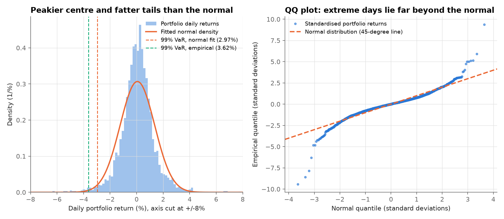
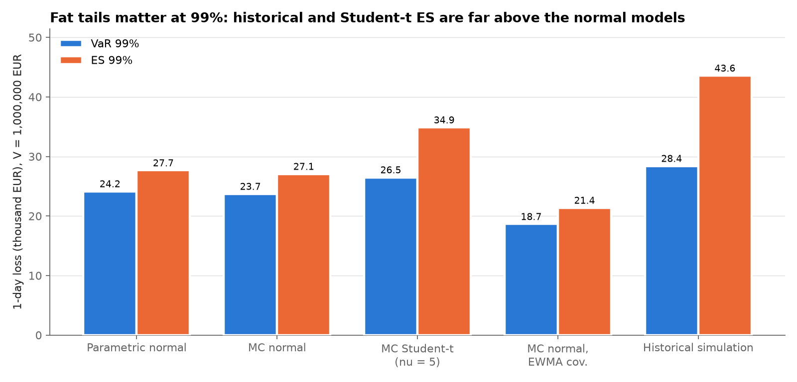
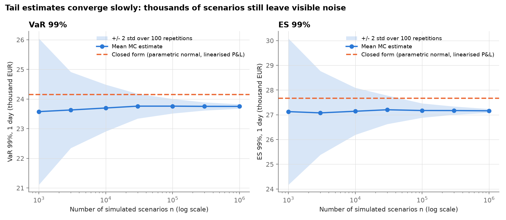
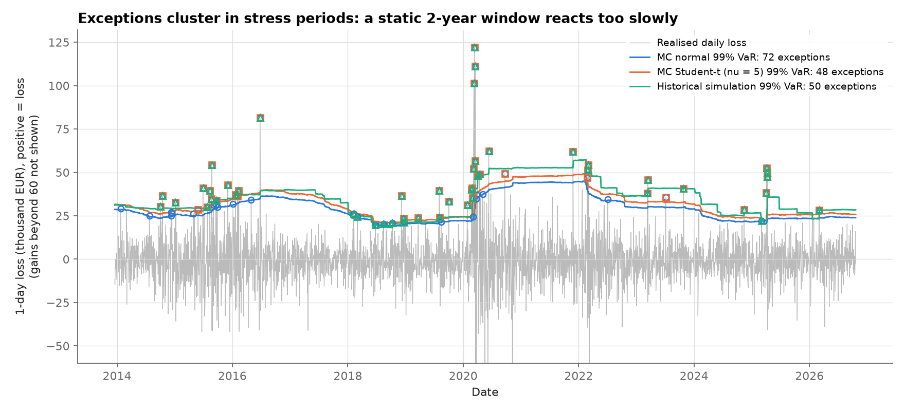

# Part 4: Value at Risk and Expected Shortfall

[Back to the README](../README.md) · [Part 1](part1_european_options.md) · [Part 2](part2_variance_reduction.md) · [Part 3](part3_exotic_options.md) · [Part 4](part4_var_es.md)

Reproduce with `python scripts/download_data.py` then `python scripts/run_part4.py` from the repository root.

The last part moves from pricing to risk measurement, on **real market data**. It computes the 1-day VaR and ES of an equally weighted portfolio of five CAC 40 stocks with four methods, then backtests them over almost 13 years (3,285 trading days).

## Definitions and conventions

Losses are **positive** numbers. For a confidence level $\alpha$ (95%, 97.5% and 99%; 97.5% is the level used for ES in the Basel FRTB framework):

$$\mathrm{VaR}_\alpha = \inf\lbrace \ell : P(L \le \ell) \ge \alpha\rbrace, \qquad \mathrm{ES}_\alpha = \mathbb{E}\big[L \mid L \ge \mathrm{VaR}_\alpha\big].$$

VaR says "on 99% of days we lose less than this". ES answers the question VaR ignores: *how much do we lose on the other 1%?*

Daily **log** returns $r_i$ are modelled, but the portfolio P&L is computed exactly from simple returns, with value $V = 1{,}000{,}000$ EUR and weights $w_i = 1/5$:

$$L = -V\sum_{i} w_i\,\big(e^{r_i} - 1\big).$$

The mean return is set to zero by default (`use_mean=False`) in the parametric and Monte Carlo engines. At a 1-day horizon it is negligible next to the volatility, and estimating it adds noise. For an $h$-day horizon the covariance is scaled by $h$ (square-root-of-time rule). **This is an approximation**: it assumes i.i.d. returns, which volatility clustering contradicts.

## Methods

**Correlated returns by Cholesky.** Write the covariance as $\Sigma = LL^\top$ with $L$ lower triangular. If $z$ is a vector of independent standard normals ($\operatorname{Cov}(z) = I$), then $x = Lz$ satisfies $\operatorname{Cov}(x) = L\,I\,L^\top = \Sigma$. Multiplying by $L$ turns independent shocks into shocks with the right variances *and* correlations.

1. **Parametric normal (closed form).** The portfolio return is *linearised*, $\sum_i w_i r_i \approx \sum_i w_i(e^{r_i}-1)$. It is then normal with $\sigma_p = \sqrt{w^\top\Sigma w}$, so that $\mathrm{VaR}_\alpha = V(z_\alpha\sigma_p - \mu_p)$ and $\mathrm{ES}_\alpha = V\big(\sigma_p\,\varphi(z_\alpha)/(1-\alpha) - \mu_p\big)$, where $z_\alpha$ is the standard normal $\alpha$-quantile and $\varphi$ its density.
2. **Monte Carlo normal.** $x = Lz$ through Cholesky, with each scenario revalued exactly.
3. **Monte Carlo Student-t** ($\nu = 5$ by default). $x = \sqrt{\tfrac{\nu-2}{\nu}}\,\dfrac{Lz}{\sqrt{W}}$, with $W \sim \chi^2_\nu/\nu$. The vector $Lz/\sqrt{W}$ has covariance $\Sigma\,\nu/(\nu-2)$, and the factor $\sqrt{(\nu-2)/\nu}$ brings it back to exactly $\Sigma$. The normal and t models therefore share variances and correlations and differ only in shape. Because a single $W$ scales all assets, a "turbulent" scenario (small $W$) hits every stock at once. This is **tail dependence**, which the multivariate normal does not have.
4. **Historical simulation.** Apply each of the last 500 days of actual (raw, not demeaned) returns to today's portfolio and take the empirical quantile and tail mean. Nothing is simulated or assumed, and the `use_mean` flag does not apply.
5. **Monte Carlo normal with EWMA covariance** (RiskMetrics, $\lambda = 0.94$). Same as 2, but the covariance is $\Sigma = \sum_k (1-\lambda)\lambda^k\, r_{t-k}r_{t-k}^\top$ (weights rescaled to sum to 1 over the window). Recent days count more, with an effective memory of about $1/(1-\lambda) \approx 17$ days.

**The 95% vs 99% crossover.** A unit-variance $t_5$ has its 95% quantile at $\sqrt{3/5}\times 2.015 = 1.561$, *below* the normal's 1.645. Its 99% quantile is $\sqrt{3/5}\times 3.365 = 2.606$, *above* the normal's 2.326. With the same variance, the t puts more mass in the centre and in the far tails and less in the "shoulders", so it is only riskier far out. A fat-tailed model can therefore give a *lower* 95% VaR and a *higher* 99% VaR than the normal.

## Data

| Ticker | Company | Sector |
|---|---|---|
| MC.PA | LVMH | Luxury |
| TTE.PA | TotalEnergies | Energy |
| SAN.PA | Sanofi | Healthcare |
| BNP.PA | BNP Paribas | Banking |
| AIR.PA | Airbus | Aerospace |

- **Source:** Yahoo Finance via `yfinance` (version 1.7.0), daily adjusted close prices (`auto_adjust=True`) in EUR.
- **Download date:** 2026-10-22.
- **Period:** 2012-01-02 to 2026-10-20, giving 3,786 aligned prices (no rows dropped) and 3,785 daily returns.
- **Sanity checks:** no non-positive prices. One return is flagged by the $|r| > 25\%$ check and kept after review: Airbus on 2020-03-18 (log return -25.06%), during the COVID-19 crash.
- **Regeneration:** the data is not committed (`data/` is in `.gitignore`), because Yahoo Finance data should not be redistributed. Run `python scripts/download_data.py` to regenerate it. Re-downloading later extends the period and can change adjusted prices slightly, so the numbers below are those of the 2026-10-22 download. The tests do not use this data.

**Summary (full sample, daily log returns):**

| Asset | Annualised volatility | Skewness | Excess kurtosis | Worst day | Best day |
|---:|---:|---:|---:|---:|---:|
| MC.PA | 27.2% | 0.16 | 3.93 | -9.08% | 12.06% |
| TTE.PA | 25.7% | -0.60 | 13.26 | -18.16% | 14.04% |
| SAN.PA | 22.4% | -1.29 | 17.01 | -20.99% | 8.10% |
| BNP.PA | 31.3% | -0.45 | 7.48 | -19.12% | 16.54% |
| AIR.PA | 33.1% | -0.39 | 14.91 | -25.06% | 18.62% |
| Portfolio | 20.7% | -0.59 | 9.89 | -13.02% | 11.55% |

Correlations range from 0.28 (Sanofi-Airbus) to 0.54 (BNP-TotalEnergies and BNP-Airbus); the full matrix is in [`results/part4_correlation.csv`](../results/part4_correlation.csv). Every asset and the portfolio have strongly positive excess kurtosis (a normal has 0): **returns are fat-tailed**.

## Results on the last date

Estimation window: the last 500 days (2024-11-04 to 2026-10-20). 1-day horizon, EUR, Monte Carlo with 500,000 scenarios.

| Method | VaR 95% | ES 95% | VaR 97.5% | ES 97.5% | VaR 99% | ES 99% |
|---:|---:|---:|---:|---:|---:|---:|
| Parametric normal | 17,077 | 21,415 | 20,348 | 24,271 | 24,152 | 27,670 |
| MC normal | 16,811 | 21,013 | 19,998 | 23,796 | 23,717 | 27,071 |
| MC Student-t (nu = 5) | 15,903 | 22,738 | 20,278 | 27,661 | 26,497 | 34,880 |
| MC normal, EWMA cov. | 13,199 | 16,563 | 15,761 | 18,764 | 18,650 | 21,379 |
| Historical simulation | 14,708 | 23,729 | 20,070 | 30,408 | 28,154 | 43,331 |

What the numbers show:

- **MC normal reproduces the closed form, up to linearisation.** The MC normal 99% VaR (23,717) is 1.8% below the parametric one (24,152). Across 100 repetitions, the standard deviation of the MC estimate is only 54.5 EUR, so this gap is not noise. It comes from the closed form's linear P&L. Since $e^{r} - 1 > r$, a stock that falls loses slightly less than the linear approximation says, and the exact revaluation in the Monte Carlo captures this.
- **The Student-t crossover appears on real data.** Compared with the normal (same covariance), the t model gives a *lower* 95% VaR (15,903 vs 16,811) and a *higher* 99% VaR (26,497 vs 23,717). Its ES is higher at every level, because ES looks into the tail itself.
- **Historical simulation gives the largest 99% VaR and ES** (28,154 and 43,331). The window contains a cluster of large losses in spring 2025 (Figure 12), which no normal model with the same variance reproduces. Its 99% ES is 1.54 times its VaR, against 1.14 for the normal model: the empirical tail beyond the VaR is much heavier.
- **EWMA gives the lowest risk** (18,650 at 99%): the most recent weeks were calmer than the two-year average.

**10-day 99% VaR and ES** (covariance $\times 10$; historical simulation scaled by $\sqrt{10}$):

| Method | VaR 99% | ES 99% |
|---:|---:|---:|
| Parametric normal | 76,376 | 87,501 |
| MC normal | 72,425 | 82,523 |
| MC Student-t (nu = 5) | 80,450 | 104,370 |
| MC normal, EWMA cov. | 57,221 | 65,362 |
| Historical simulation x sqrt(10) | 89,031 | 137,025 |

The parametric 10-day VaR is exactly $\sqrt{10}$ times the 1-day value. The MC normal 10-day VaR (72,425) is below $\sqrt{10} \times 23{,}717 \approx 75{,}000$, because the convexity of $e^r - 1$ grows with the size of the moves.

**Student-t sensitivity to $\nu$** (1-day, 99%, same covariance). Lower $\nu$ means fatter tails and higher VaR and ES; the effect on ES is much larger. Each row is an independent Monte Carlo run, so the $\nu = 5$ row (26,327) differs from the main table (26,497) by Monte Carlo noise; the normal row is the main-table MC normal run.

| nu | VaR 99% | ES 99% |
|---:|---:|---:|
| 4 | 27,138 | 37,336 |
| 5 | 26,327 | 34,835 |
| 8 | 25,441 | 31,420 |
| 30 | 24,275 | 28,214 |
| normal (infinite) | 23,717 | 27,071 |

**Monte Carlo uncertainty** (MC normal, 100 independent repetitions of 500,000 scenarios, EUR):

| Level | Mean VaR | Std VaR | Mean ES | Std ES |
|---:|---:|---:|---:|---:|
| 95% | 16,837 | 36.8 | 21,079 | 38.1 |
| 97.5% | 20,042 | 42.8 | 23,868 | 46.1 |
| 99% | 23,754 | 54.5 | 27,178 | 60.2 |

**Convergence: tail estimates need many scenarios.** The last two columns give the standard deviation of the estimate divided by $\sigma_pV/\sqrt{n}$, which is the standard error of a simple *mean* with the same $n$.

| n | Mean VaR | Std VaR | Mean ES | Std ES | Std VaR / (sigma_p V / sqrt n) | Std ES / (sigma_p V / sqrt n) |
|---:|---:|---:|---:|---:|---:|---:|
| 1,000 | 23,576 | 1,234 | 27,129 | 1,478 | 3.76 | 4.50 |
| 3,000 | 23,631 | 642 | 27,078 | 847 | 3.39 | 4.47 |
| 10,000 | 23,698 | 395 | 27,143 | 475 | 3.80 | 4.58 |
| 30,000 | 23,761 | 209 | 27,204 | 289 | 3.49 | 4.82 |
| 100,000 | 23,761 | 123 | 27,174 | 145 | 3.73 | 4.41 |
| 300,000 | 23,754 | 69 | 27,172 | 83 | 3.62 | 4.38 |
| 1,000,000 | 23,752 | 38 | 27,162 | 39 | 3.70 | 3.77 |

The 99% VaR estimate is about 3.4 to 3.8 times noisier than a mean estimated from the same number of scenarios, and ES about 3.8 to 4.8 times. (The asymptotic value for a normal quantile is $\sqrt{0.99 \times 0.01}/\varphi(z_{0.99}) \approx 3.73$.) Matching the precision of a mean therefore takes roughly $3.7^2 \approx 14$ times more scenarios for VaR, and more for ES. The estimates still converge at the $1/\sqrt{n}$ rate. They converge to the exact-P&L value, not to the dashed linearised closed form, which explains the visible gap in Figure 11.

## Backtest

Rolling 1-day forecasts from 2013-12-18 to 2026-10-20 (3,285 days). Each forecast uses only the previous 500 days (no look-ahead; a test checks this), with 20,000 scenarios per Monte Carlo forecast. **Common random numbers:** the same normal matrix and chi-square vector are reused every day and only the covariance changes. This removes day-to-day simulation noise from the VaR series, but it makes the Monte Carlo error of consecutive days correlated.

**Tests used:**

- **Kupiec (POF):** is the exception rate equal to $1-\alpha$?
- **Christoffersen independence:** is an exception today independent of yesterday's?
- **Conditional coverage (CC):** both at once.
- **Basel (1996) traffic light:** green, yellow or red zone, from the number of 99% exceptions over the last 250 days. Used here for illustration only.
- **ES diagnostic** (no formal test): if the ES is right, the average loss on exception days should be close to the average ES predicted for those days.

| Method | Level | Exceptions | Expected | Rate | Kupiec p | Indep. p | CC p | Last 250 d | Avg loss on exc. | Avg predicted ES |
|---:|---:|---:|---:|---:|---:|---:|---:|---:|---:|---:|
| Parametric normal | 99% | 63 | 32.9 | 1.92% | <0.0001 | 0.0002 | <0.0001 | 1 (green) | 41,223 | 31,701 |
| MC normal | 99% | 72 | 32.9 | 2.19% | <0.0001 | 0.0002 | <0.0001 | 1 (green) | 39,731 | 31,080 |
| MC Student-t (nu = 5) | 99% | 48 | 32.9 | 1.46% | 0.0129 | <0.0001 | <0.0001 | 1 (green) | 45,811 | 40,074 |
| MC normal, EWMA cov. | 99% | 75 | 32.9 | 2.28% | <0.0001 | 0.0351 | <0.0001 | 5 (yellow) | 34,258 | 28,405 |
| Historical simulation | 99% | 51 | 32.9 | 1.55% | 0.0032 | 0.0001 | <0.0001 | 2 (green) | 42,739 | 42,226 |
| Parametric normal | 95% | 150 | 164.3 | 4.57% | 0.2473 | <0.0001 | <0.0001 | 7 | 30,533 | 24,054 |
| MC normal | 95% | 155 | 164.3 | 4.72% | 0.4549 | <0.0001 | <0.0001 | 7 | 30,117 | 23,522 |
| MC Student-t (nu = 5) | 95% | 174 | 164.3 | 5.30% | 0.4393 | <0.0001 | <0.0001 | 8 | 28,939 | 25,455 |
| MC normal, EWMA cov. | 95% | 194 | 164.3 | 5.91% | 0.0204 | <0.0001 | <0.0001 | 13 | 25,306 | 21,384 |
| Historical simulation | 95% | 176 | 164.3 | 5.36% | 0.3522 | <0.0001 | <0.0001 | 10 | 28,975 | 27,513 |

**Discussion.**

- **No model passes at 99%.** Every 99% VaR has too many exceptions, and Kupiec rejects all five at the 5% level. The normal models are worst (63 and 72 exceptions against 32.9 expected). The fat-tailed models come closest: Student-t 48 (p = 0.0129) and historical 51 (p = 0.0032).
- **At 95%, the exception rate is fine for four models out of five.** Kupiec does not reject the parametric normal, MC normal, Student-t or historical models; it does reject EWMA (p = 0.0204). This matches the crossover: the normal is only too thin in the far tail. At 95% the Student-t has *more* exceptions than the normal (174 vs 155), exactly as its lower 95% VaR predicts.
- **Every model fails the independence test, at both levels.** Exceptions cluster in stress periods: the MC normal model has 17 of its 72 exceptions in 2020 and 13 in 2015, against 0 in 2017. This is **volatility clustering**: calm and turbulent periods alternate, and a 500-day equally weighted window reacts slowly to both. It underestimates risk when a crisis starts and overestimates it afterwards. Figure 12 shows the reverse "ghost" effect: the equally weighted VaR drops sharply in early 2022, when the March 2020 crash leaves the 500-day window, without anything happening in the market that day.
- **EWMA reduces clustering but does not fix the tails.** With a 17-day memory, EWMA has fewer back-to-back exceptions than the MC normal model (5 pairs of consecutive exceptions vs 8). Its independence p-value rises from 0.0002 to 0.0351, still a rejection at 5%. But it has the *most* exceptions (75 at 99%, 194 at 95%). EWMA fixes the *level* of volatility but keeps a normal *shape*: after calm stretches its forecast volatility is low, and the conditional tails are still thinner than reality. Combining EWMA with fat tails (Student-t innovations or filtered historical simulation) would address both problems; it is not implemented here.
- **The normal ES is too optimistic.** On 99% exception days, the average realised loss exceeds the average predicted ES for every model: 39,731 vs 31,080 for the MC normal, 45,811 vs 40,074 for the Student-t, and only 42,739 vs 42,226 for historical simulation. Historical simulation is the only model whose ES is close to what actually happened in the tail.
- **The parametric and MC normal models differ in the backtest** (63 vs 72 exceptions) even though their VaRs differ by only about 2% (exact P&L, plus the noise of 20,000 scenarios). Near the 99% quantile, small changes in VaR move the exception count noticeably.
- **The traffic light over the last 250 days is green for all models except EWMA** (5 exceptions, yellow). Taken alone, that window would hide the problems that the full backtest reveals.

## Assumptions and limitations

- **i.i.d. returns and square-root-of-time scaling.** The backtest shows that returns are *not* i.i.d. (clustered exceptions), so 10-day figures obtained by $\sqrt{10}$ scaling are approximations.
- **Portfolio scope.** It is a linear portfolio of five cash equities with no options, rebalanced to equal weights every day in the backtest. Options would require full revaluation of non-linear payoffs in each scenario.
- **Covariance estimation error.** A 500-day sample covariance is estimated with error, and that error is ignored. Only five assets are used, so diversification and estimation issues are much smaller than in a real book.
- **Common random numbers** in the backtest make the Monte Carlo errors of consecutive days correlated.
- **No formal ES backtest** (for example Acerbi-Szekely); only the average-loss diagnostic above.
- **For illustration only.** This is not a regulatory model: the traffic light is used only as an illustration, and FRTB uses ES at 97.5% with liquidity horizons, stressed periods and other features not covered here.

## Tests

`tests/test_risk.py` uses synthetic data only (no network, no downloaded file) and checks:

- Cholesky draws have the target covariance, and a non positive definite matrix is rejected. MC normal VaR/ES match the closed form at 95/97.5/99% within 4 standard errors (with small volatilities, so that the linearisation error of the closed form stays below the tolerance). The parametric VaR scales exactly with $\sqrt{h}$.
- Student-t engine: it has the target covariance and positive excess kurtosis, tends to the normal for $\nu = 1000$, and shows the 95%/99% crossover (higher VaR than the normal at 99%, lower at 95%).
- Historical simulation: VaR equals `np.quantile` of the losses of the raw returns, whatever the `use_mean` flag; ES is always at least VaR; weights must sum to 1.
- Backtest statistics: Kupiec is 0 when the exception count equals its expectation, matches a hand-computed value (5 exceptions in 250 days at 1%) and rejects a wrong rate. Christoffersen rejects clustered exceptions but not spread-out ones. Edge cases (0 or only exceptions) are handled, and traffic-light boundaries are checked.
- On i.i.d. normal data the rolling backtest is calibrated (Kupiec not rejected), and a crash on day $t$ does not change the forecast for day $t$ (no look-ahead).

## Output files

Written by the script to [`results/`](../results):

- [`part4_data_summary.csv`](../results/part4_data_summary.csv): per-asset and portfolio summary statistics.
- [`part4_correlation.csv`](../results/part4_correlation.csv): correlation matrix.
- [`part4_var_es_1day.csv`](../results/part4_var_es_1day.csv): 1-day VaR and ES on the last date.
- [`part4_var_es_10day.csv`](../results/part4_var_es_10day.csv): 10-day 99% VaR and ES.
- [`part4_student_t_nu.csv`](../results/part4_student_t_nu.csv): Student-t sensitivity to nu.
- [`part4_mc_uncertainty.csv`](../results/part4_mc_uncertainty.csv): MC normal uncertainty over 100 repetitions.
- [`part4_backtest.csv`](../results/part4_backtest.csv): backtest statistics per method and level.
